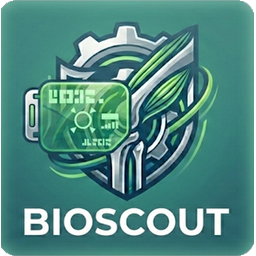

<p align="center">
  
</p>

<h1 align="center">BioScout Web</h1>

<p align="center">V2 &nbsp;·&nbsp; <em>runs entirely in your browser — nothing to install, no server</em></p>

<p align="center"><strong>Movement tracking and musculoskeletal modelling in a web page.</strong></p>

<p align="center">
<a href="https://basgoncalves.github.io/bioscout-web/"><b>Open the app → basgoncalves.github.io/bioscout-web</b></a><br>
The browser front end of <a href="https://pypi.org/project/bioscout/">BioScout</a> (Python) · see <a href="LICENSE">License</a>
</p>

---

## Why BioScout Web

Two things usually need a lab PC: filming a movement and turning it into joint
angles and loads, and taking a motion-capture trial all the way through OpenSim
to muscle and joint contact forces. BioScout Web does both in the browser.

- **Record.** A phone camera feeds on-device pose estimation; the joint angles go
  through inverse dynamics, and the result sits in a log of everything around it
  (training, meals, weight, sleep, vitals, mood, cycle). The video never leaves
  the device.
- **Process.** Open lab files (force plates, EMG, motion capture, OpenSim results),
  filter, plot and analyse them.
- **Simulate.** Take a `.c3d` from marker and force-plate data through Scale,
  inverse kinematics, inverse dynamics, muscle analysis, static optimisation,
  joint reaction loads and a Python version of CEINMS — **in the browser, with no
  OpenSim install and no lab-engine server.** The tools are pure-Python rewrites
  (`py/pyosim`) running in [Pyodide](https://pyodide.org) (Python compiled to
  WebAssembly), checked against OpenSim on the same data. Results and figures are
  written straight into your folders, in the layout the Python BioScout reads.

No app store, no build step. The two repositories are kept apart on purpose:
this one deploys as a static site on every push, and the Python package goes to
PyPI without 45 MB of pose engine attached. They share the analysis core, and a
test enforces that (see [Verification](#verification)).

**Contents:** [Quick start](#quick-start) · [How the app works](#how-the-app-works) ·
[Simulate in the browser](#simulate-in-the-browser) · [Module reference](#module-reference) · [Outputs](#outputs) ·
[What it measures](#what-it-measures-and-what-it-does-not) ·
[Privacy](#privacy) · [Optional helpers](#optional-local-helpers) ·
[Verification](#verification) · [Layout](#repository-layout)

---

## Quick start

```bash
python serve.py              # http://localhost:8000, caching off
npm test                     # every tests/test_*.mjs, nothing to install
```

- **Open it as `localhost`**, not `127.0.0.1`. Browsers only allow the camera
  on a secure context, and `localhost` counts as one.
- **On a phone**, use HTTPS through a tunnel (`npx localtunnel --port 8000` or
  `cloudflared tunnel --url http://localhost:8000`).
- **Versions.** The plain link opens the **lab demo** (`?lab=1`): Record,
  Process, Simulate and the [glossary](glossary/). The full app (athletes,
  training log, accounts) is **developer mode**. It opens from the lab home's
  *Developer mode* button (password `DEV_PASSWORD` in `index.html`) or by
  loading `#viewLogin` directly, and lasts for that tab only.
- **Glossary**: [`glossary/`](https://basgoncalves.github.io/bioscout-web/glossary/)
  lists every variable, metric and term, searchable, A–Z or by topic.
- **Without a camera**, `?demo=1` (or `?demo=squat`) renders a stored result.
- **Deploying**: push to `main` and GitHub Pages serves the repository root.
  The first load is about 45 MB (pose engine plus model). After that the
  service worker caches everything and the app works offline. *Add to Home
  screen* installs it as a PWA.

### Filming

- Film side on, with the whole body in frame, from about 3 m away.
- **Prop the phone up.** Everything is measured in image coordinates, so a
  moving camera looks the same as a moving body.
- Set your height first, because every output in metres scales with it.
- For squats, stand still for a moment at the start. For pull-ups, start from
  a full dead hang.

---

## Simulate in the browser

Simulate used to need the *lab engine*, a Python + OpenSim server on a lab PC.
It does not any more: every step below runs in a Web Worker on your own computer,
and files are read from and written to your folders through the browser's
File System Access API (Chrome / Edge; other browsers get a `.zip`).

| Step | What runs | Checked against OpenSim |
|---|---|---|
| C3D export | `c3dexport.js`: markers → `.trc`, force plates → `grf.mot`, analogs → `emg.mot` | — |
| Scale | `pyosim/scale.py`: marker-pair scaling + marker placement, body mass from the static trial | — |
| Inverse kinematics | `pyosim/ik.py`: weighted least squares per frame, couplers honoured; also writes `body_positions.sto` | joint angles within 0.015° |
| Inverse dynamics | `pyosim/id.py`: batched Newton–Euler with the external loads | moments, 0.4 s for a trial |
| Muscle analysis | `pyosim/muscles.py`, `ma.py`: paths with via points and cylinder / sphere wrapping, moment arms | lengths ~0.5 mm, moment arms ~1 mm (median) |
| Static optimisation | `pyosim/so.py`: min Σ a², rigid-tendon Hill curves, reserve actuators | soleus 1607 vs 1603 N |
| Joint reactions | `pyosim/jra.py`: subtree Newton–Euler with the muscle forces, in the child frame | vertical hip/knee within ~10 %, ankle ~2 % |
| CEINMS (Python version) | `pyosim/ceinms.py`: calibration (strengths + EMG shape) and execution (α·moments + β·effort + γ·EMG; execution / loop / optimise) | **not CEINMS.exe** — same idea, simpler muscle model |

Each step writes the figures the Python BioScout writes (marker errors, joint
angles and moments with the skeleton and GRF at the events, residuals, muscle
groups, muscle moments, joint reaction forces and their polar coverage plots).
Residual reduction analysis is the one step still left to the lab engine, which
can be connected for it.

Three ways to run it, as tabs on the Simulate page:

- **Step-by-step** — one section per tool, each with its own Run button, file
  slots, setup `.xml` and output folder.
- **Quick run** — pick a `.c3d` folder and a trial; every ticked step runs and the
  results go to `<trial>_simulation/` next to the c3d. A *setup files* folder
  (e.g. a project's `setupFiles/`) supplies the marker set, IK task set and scale
  setup that match the lab's marker names. *Redo figures only* redraws every
  figure from the files already there.
- **Batch mode** — a BioScout project (`session.yaml`, `1_c3dfiles/`,
  `2_experimental/`, `3_iterations/<iteration>/<trial>/…`): ticked steps for ticked
  trials, one scaled model and one CEINMS calibration per iteration, outputs in
  `external_biomechanics/`, `muscle_analysis/`, `static_optimisation/`,
  `joint_contact_forces/` and `ceinms/` — the folders the Python BioScout opens.

The first Simulate run downloads Pyodide with numpy and scipy (~20 s, then cached).

---

## How the app works

One recording passes through a chain of stages. Each stage is a plain ES
module in `src/` with its own test in `tests/`. Click a stage to jump to its
entry in the [module reference](#module-reference).

```
camera ─► pose ─► framing ─► kinematics ─► detect ─► reps ─► dynamics ─► forces ─► log / export
```

| # | Stage | What happens | Modules |
|---|---|---|---|
| 1 | Capture | Camera, lens choice, hands-free start and stop | [`gesture`](#gesture) · [`framing`](#framing) · [`protocol`](#protocol) · [`resttimer`](#resttimer) |
| 2 | Pose | MediaPipe Pose Landmarker (WASM, vendored) gives 33 landmarks per frame. Only these coordinates are kept. | `index.html`, `assets/vendor/` |
| 3 | Kinematics | Pose features, pixel-to-metre scaling, joint angles, `.mot` export | [`kinematics`](#kinematics) · [`jointmetrics`](#jointmetrics) |
| 4 | Detection | Works out which movement was done and splits it into reps | [`detect`](#detect) · [`repquality`](#repquality) · [`ensemble`](#ensemble) · [`balltrack`](#balltrack) |
| 5 | Dynamics | Ground reaction from whole-body Newton, then sagittal inverse dynamics | [`grf`](#grf) · [`dynamics`](#dynamics) · [`loaddir`](#loaddir) |
| 6 | Forces | Surrogate model for muscle and joint contact forces | [`forces`](#forces) · [`armmuscles`](#armmuscles) · [`neckmuscles`](#neckmuscles) · [`jointload`](#jointload) · [`muscle_groups`](#muscle_groups) |
| 7 | Log | Sessions, the training calendar and the day's other records | [`profiles`](#profiles) · [`dashboard`](#dashboard) · [Daily log](#daily-log) |
| 8 | Out | Files, share cards, cloud sync, OpenSim export | [`osimexport`](#osimexport) · [`share`](#share) · [`sharepost`](#sharepost) · [`cloud`](#cloud) · [`zip`](#zip) |

The query string selects special modes: `?demo=1` for the stored demo,
`?demo=squat` for the squat view.

---

## Module reference

Each entry gives the module's role and what it **in**puts and **out**puts.

### Capture

<a id="gesture"></a>
#### `gesture.js`
Starts and stops a recording from across the room with a pose gesture, so the
phone can stay propped up.

<a id="framing"></a>
#### `framing.js`
Checks that the body is actually inside the picture before and during
recording, and warns when limbs leave the frame.

<a id="protocol"></a>
#### `protocol.js`
Runs scripted sessions to a fixed timeline, such as the Tom Holland circuit
and Tabata. It drives the recorder's work and rest phases.

<a id="resttimer"></a>
#### `resttimer.js`
Shows the rest countdown between sets.

### Analysis core

<a id="kinematics"></a>
#### `kinematics.js`
The movement-agnostic core: pose features, rep detection, joint angles,
pixel-to-metre scaling, `.mot` export and the activity table. It is a
line-by-line port of `bioscout.movement_detector.markerless` and is pinned
to it by [Verification](#verification).
**In:** landmarks, height. **Out:** per-frame angles and reps.

<a id="jointmetrics"></a>
#### `jointmetrics.js`
Computes angle, angular velocity, moment and power for each joint. These feed
the four per-joint plots and their joint tick boxes.

<a id="detect"></a>
#### `detect.js`
Works out which movement was performed from kinematics alone. It covers squat,
pull-up, push-up, dip, jumps, jump shot, kickback, heel raise, running,
walking and strokes.

<a id="repquality"></a>
#### `repquality.js`
Crops each rep to the movement and grades it as *clean*, *acceptable* or
*poor*. Reps can be removed and restored.

<a id="ensemble"></a>
#### `ensemble.js`
Time-normalises the reps of a set and averages them into the mean rep.

<a id="balltrack"></a>
#### `balltrack.js`
Finds a tennis or padel ball in the camera picture, and says only what can
honestly be said about it afterwards.

### Dynamics and forces

<a id="grf"></a>
#### `grf.js`
Estimates the vertical reaction force under each foot and each hand.

<a id="dynamics"></a>
#### `dynamics.js`
Sagittal inverse dynamics, ported from `kinematics/dynamics.py`. The ground
reaction is derived from `GRF = m(a_com + g)`, not assumed, and segment
inertias follow Winter Table 4.1.
**Out:** hip, knee and ankle moments in N·m, extension positive.

<a id="loaddir"></a>
#### `loaddir.js`
Records which way an added load acts (bar, vest, cable), so the moments carry
the right external force.

<a id="forces"></a>
#### `forces.js`
The browser forward pass of the FAIS static-optimisation surrogate. It reads
`data/force_model_v2.json` and outputs 80 lower-limb muscle forces plus joint
contact forces. See the [limits](#what-it-measures-and-what-it-does-not).

<a id="armmuscles"></a>
#### `armmuscles.js`
Upper-body muscle forces for pull-up, dip and jump shot, from the major arm
muscles of the Digital Athlete model.

<a id="neckmuscles"></a>
#### `neckmuscles.js` · `neck_load.js` · `neckload.js` · `neck_gload.js`
Neck moments and muscle forces for isometric holds against a known load, plus
neck training load, a capacity test and the 1-6 g reference panel. The
reference values are private (see [Not in this repository](#not-in-this-repository)).

<a id="jointload"></a>
#### `jointload.js`
Draws one figure per task showing where the joint contact forces point at the
key instants, in a sagittal or frontal view.

<a id="muscle_groups"></a>
#### `muscle_groups.js`
Groups the model's muscle names into functional groups for display.

### Training and history

<a id="profiles"></a>
#### `profiles.js`
Athlete profiles and the running training session. This is the store most
other modules write into.

<a id="dashboard"></a>
#### `dashboard.js`
The training history: what was done, and on which days.

<a id="sports"></a>
#### `sports.js` · `bodymap.js`
Choose a session's sport and its movements, and pick strength exercises on a
male or female body map.

<a id="plans"></a>
#### `plans.js`
Training planned for a future day, and how much of it got done.

<a id="trainsummary"></a>
#### `trainsummary.js` · `athsummary.js`
The training summary charts, plus the athlete summary page with week, month,
three-month and year means side by side.

<a id="achievements"></a>
#### `achievements.js`
Badges at 10, 100, 500 and 1000 lifetime reps of each movement.

<a id="assess"></a>
#### `assess.js` · `rtp.js` · `reaction.js`
The physical assessment (three guided tests, one report) and return-to-play
guidance by body part, injury and phase. Also the finger reaction-time games,
which need no camera.

<a id="cardio"></a>
#### `cardio.js` · `strava.js`
Endurance sessions, which have time and distance instead of reps, and
importing them through the [Strava helper](#optional-local-helpers).

<a id="energy"></a>
#### `energy.js`
Estimates a session's kilocalories from RPE or heart rate, and what that
implies for the day's macronutrients.

<a id="daily-log"></a>
### Daily log

| Module | Records |
|---|---|
| `weight.js` | Body mass as a step function, with week, month and year timelines |
| `bodyfat.js` | Body-fat percentage from two camera pictures |
| `foods.js` | Meals: grams in, calories out |
| `water.js` | Glasses of water and cups of coffee per day |
| `sleep.js` | Time in bed |
| `vitals.js` | Steps, resting heart rate and blood pressure |
| `diary.js` | Mood and the shape of the day, Daylio-style |
| `cycle.js` | Menstrual cycle |
| `health.js` | A health rating that grows from the above |

### Lab and OpenSim

<a id="osimexport"></a>
#### `osimexport.js`
Writes a set in the Python bioscout session layout, so a phone trial and a
Vicon trial of the same movement go through the same pipeline.

<a id="osimlab"></a>
#### `process.js` · `proc_io.js` · `proc_dsp.js`
The Process page: reads marker, force-plate, EMG and OpenSim files, filters and plots them.

<a id="simtools"></a>
#### `simtools.js` · `simquick.js` · `simsession.js` · `localengine.js` · `pyosim_worker.js` · `py/pyosim/`
The Simulate page and its three modes (see [Simulate in the browser](#simulate-in-the-browser)).
`localengine.js` gives the page the same client API the lab engine had, but runs
the tools in `pyosim_worker.js` (Pyodide) on the pure-Python OpenSim rewrites in
`py/pyosim/`. `simfigs.js` and `simstack.js` draw the figures; `c3dexport.js`
turns a `.c3d` into OpenSim files. `osimlab.js` still talks to a lab engine when
one is connected (residual reduction analysis).

### Accounts, sharing, help

<a id="cloud"></a>
#### `cloud.js` · `cloud_config.js` · `syncmeta.js` · `friends.js`
Optional accounts with private sync on Supabase (EU). `syncmeta.js` holds the
single merge rule (timestamps and tombstones). `friends.js` covers usernames
and what friends can see. The schema is in `supabase/schema.sql`.

<a id="share"></a>
#### `share.js`
The shareable month card: which numbers go on it, and where it is sent.

<a id="sharepost"></a>
#### `sharepost.js` · `media.js`
Shares one set as a picture or short clip, to the share sheet or the BioScout
feed. Photos are stored in IndexedDB, not localStorage.

<a id="help"></a>
#### `help.js` · `chat.js`
The Help & chat screen: a keyword FAQ and data bot with no AI model and no
network calls, plus a contact card.

<a id="zip"></a>
#### `zip.js` · `i18n.js` · `fetcher.js`
A minimal ZIP writer for the session archive, the interface language
(en / pt / de, every visible string keyed), and the client for the
[link helper](#optional-local-helpers).

---

## Outputs

Per rep, downloadable:

| File | Contents |
|---|---|
| `<activity>_rep<N>_<model>_joint_angles.mot` | OpenSim coordinates, signed for the chosen model family |
| `<activity>_rep<N>_joint_moments.sto` | Hip, knee and ankle moments (N·m) and ground reaction (N) |

**Choose the right model family.** `knee_angle` has opposite signs in the two
families: Rajagopal is 0..+145 and GPK/gait2392 is −145..+10. The choice is
stamped into the filename. OpenSim accepts the wrong sign without an error and
renders a collapsed figure. `pelvis_ty` is an absolute height above the floor,
so a standing subject should come out near 0.93 m. If it does not, your
height entry is wrong.

---

## What it measures, and what it does not

- **Reliable:** rep count, joint angles, range of motion, and squat depth or
  pull-up travel in metres.
- **Approximate:** tempo. Browser frame rate varies, so the achieved rate is
  shown with the results.
- **Joint moments:** sagittal and planar. They assume the centre of pressure
  is at the midfoot and that left and right are symmetric. Moments only apply
  to tasks with ground contact.
- **Muscle and joint contact forces are estimates.** The model was trained on
  570 OpenSim SO trials from 26 subjects. On unseen subjects the median R² is
  0.46 for muscle force and 0.66 for contact force. Trust the shape and the
  ranking more than the newtons. It uses kinematics only, so it **cannot see
  external load**, and its outputs are lower-limb muscles only.
- **Single-camera limits:** one camera cannot separate left from right, so the
  `*_r` and `*_l` columns are identical. Out-of-plane motion is invisible.

---

## Privacy

Video is never uploaded or saved. Frames go from the camera to the pose model
in memory, and only the landmarks are kept. Everything is stored on the device
by default, with no analytics. An account is optional. With one, your records
sync privately to Supabase in the EU, and only what you post to the feed is
visible to friends. The full notice is in [`privacy.html`](privacy.html). The
in-app terms are kept in step with it.

### Not in this repository

| Missing | Why | Effect |
|---|---|---|
| `data/reference.json` case of a participant | Consent to record is not consent to publish | `?demo` says so; `test_port.mjs` skips |
| `src/neck_gload.js` values | Unpublished thesis results | The 1-6 g neck panel does not render |

Private material lives in the gitignored `_private/`. Do not commit it.

---

## Optional local helpers

Some features need things a static page cannot do. Each one runs as a script
you start yourself, binds `127.0.0.1` only, and the app shows its control only
while the helper is running.

| Helper | Why it is needed | Run |
|---|---|---|
| `tools/bioscout_fetch.py` | Pages cannot read video bytes across origins. The page sends only an 11-character id. | `pip install yt-dlp && python tools/bioscout_fetch.py` |
| `tools/bioscout_strava.py` | Strava OAuth needs a client secret, and the API sends no CORS headers. Tokens never leave the helper and access is read-only. | Set `STRAVA_CLIENT_ID` / `STRAVA_CLIENT_SECRET` (or `~/.bioscout/strava.json`), then `python tools/bioscout_strava.py` |

Downloading videos is subject to the platform's terms. Use the link helper
only for footage you have the rights to.

---

## Verification

`src/kinematics.js` must match the Python package exactly, including numpy's
percentile interpolation, the `convolve 'same'` offset and NaN handling. Both
sides are pinned to the same fixture:

```bash
node tests/test_port.mjs          # JS     == data/reference.json
python tools/check_reference.py   # Python == data/reference.json
python tools/dump_reference.py    # regenerate after an intended change
```

Each case stores its own input landmarks, so no video is needed. CI runs it on
every push and weekly (`.github/workflows/port.yml`). `node
tests/test_force_model.mjs` guards the force model against runaway outputs.

---

## Repository layout

```
index.html  sw.js  manifest.webmanifest     the app, offline cache, PWA manifest
privacy.html  limitations.html  formats.html   public notes linked from the app
src/        ES modules, loaded directly (see Module reference)
tests/      node tests/test_*.mjs  (npm test runs all)
data/       force model, norms, muscle tables, reference fixture, OpenSim models + setup files
py/pyosim/  pure-Python OpenSim tools (scale, IK, ID, MA, SO, JRA, CEINMS version) run in Pyodide
assets/     vendored MediaPipe, pose model, overlay meshes, icons (generated)
supabase/   schema.sql and edge functions for accounts
tools/      scripts you run: helpers, fixture tools, model/mesh/icon exporters
serve.py    local no-cache server
push.py     apply a patch and ship it from a phone
```

There is no bundler, no `node_modules` and no build step. Licence:
[LICENSE](LICENSE).
