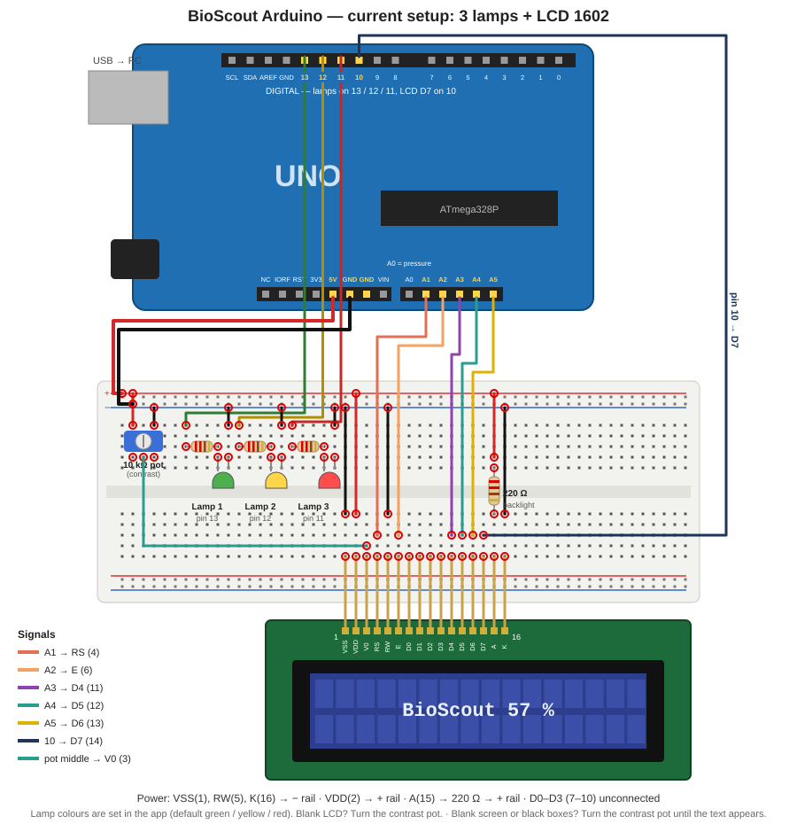
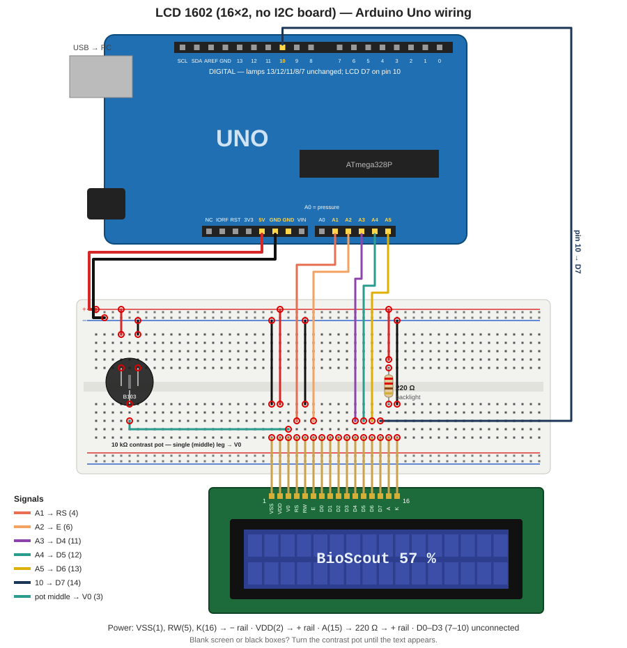
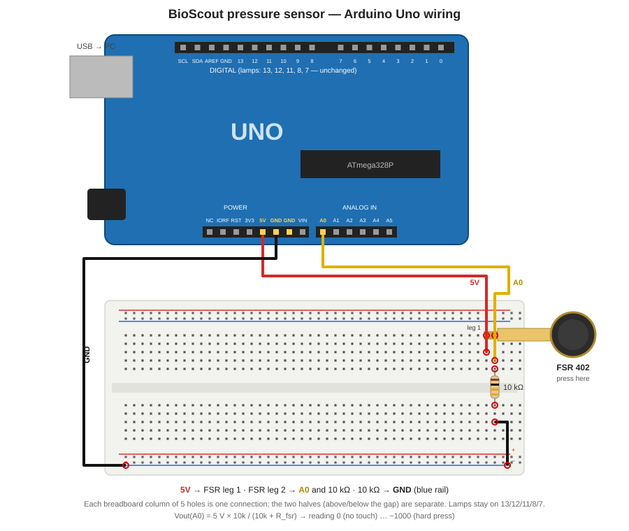
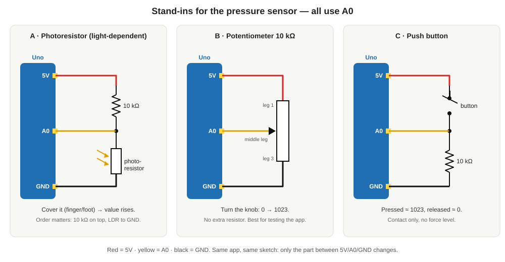
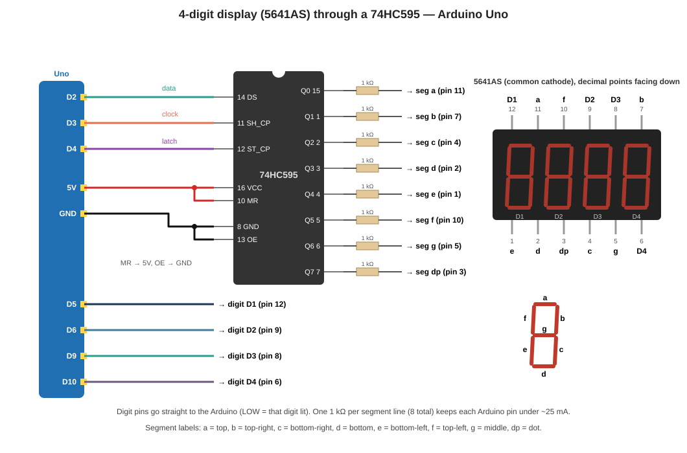

# BioScout Arduino — setup

One Arduino Uno on USB, driven by the BioScout Web **BioFeedback** page (Web Serial,
Chrome / Edge on a computer). Every part below is optional and they all share one
sketch: `assets/arduino/biofeedback_lamp/biofeedback_lamp.ino` (v7).



## 0. What is on the board now

| Part | Status | Pins |
|---|---|---|
| 3 lamps (LEDs) | **wired, working** | 13, 12, 11 |
| LCD 1602 text screen | **wired, working** (sketch v7) | A1–A5, 10 |
| Pressure sensor / stand-in | not wired | A0 |
| 4-digit 7-segment display | not wired — alternative to the LCD (shares pin 10) | 2–6, 9, 10 |

### Pin map (Uno)

| Pin | Used by | Note |
|---|---|---|
| 0, 1 | USB serial | never use |
| 2, 3, 4 | 4-digit display (74HC595 data / clock / latch) | only if the display is fitted |
| 5, 6, 9 | 4-digit display digits D1–D3 | only if the display is fitted |
| **10** | **LCD D7** — *or* 4-digit display digit D4 | LCD **or** display, not both |
| **11** | **Lamp 3** | default red |
| **12** | **Lamp 2** | default yellow |
| **13** | **Lamp 1** | default green; also the on-board "L" LED |
| 8, 7 | legacy: green "online" lamp / relay | still in the sketch, hidden in the app |
| A0 | pressure sensor | analog in |
| **A1–A5** | **LCD RS, E, D4, D5, D6** | used as digital pins; the app's analog stream (`A`) shows nonsense for A1–A5 while the LCD is wired |
| 5V / GND | breadboard + / − rails | everything shares GND |

Lamp pins can be moved from the app (Pins, kept in EEPROM); don't move a lamp onto
a pin the LCD or display uses.

---

## 1. Board and sketch

**Upload the firmware:** connect the board in the app → **Update board firmware**
(≈10 s, straight from the browser; the button only shows when the board is behind).
For your own edits: Arduino IDE → open the .ino → Board **Arduino Uno**, Port
**COMx** → Upload, then **close the IDE** (only one program can hold the port).
After changing the .ino, the bundled `.hex` must be rebuilt (test_stk500 checks it).

On connect the board prints `BIOSCOUT_LAMP_READY v7 FSR DISP LCD` and its pins.
The app tells you if the board runs an older sketch.

**Edit the sketch in the app:** Connect external device → Arduino → *Edit Arduino
sketch…* (kept in your browser) → download → upload as above. A browser cannot
compile Arduino code.

**Start the app locally:** `_private/launchers/biofeedback.bat` (branch `biofeedback`) → http://localhost:5173 → BioFeedback
→ **Connect external device → Arduino → Choose port…** → pick the Uno.

---

## 2. Lamps (3 levels)

The BioFeedback page has three thresholds; the lamps light **cumulatively**
(level 1 = lamp 1, 2 = lamps 1+2, 3 = all three) while **Activate** is on.
Colours are chosen in the app (default green / yellow / red) — use LEDs that match.

| Lamp | Pin | Serial command |
|---|---|---|
| Lamp 1 | 13 | `L1` (or `1`) |
| Lamp 2 | 12 | `L2` |
| Lamp 3 | 11 | `L3` |
| all off | — | `L0` (or `0`) |

### Parts
- 3 × LED (5 mm) in the colours you set in the app
- 3 × 220 Ω (red-red-brown) — one per LED, never shared (150 Ω–1 kΩ all work; higher = dimmer)
- 6 jumper wires

### Wiring (each lamp the same)

```
  Uno pin 13 ──[ 220 Ω ]──►|── GND      lamp 1
  Uno pin 12 ──[ 220 Ω ]──►|── GND      lamp 2
  Uno pin 11 ──[ 220 Ω ]──►|── GND      lamp 3
                       long  short
                        leg   leg (flat rim side)
```

- **Long leg (+, anode)** towards the resistor / pin; **short leg (−, cathode,
  flat side of the rim)** to the **− rail**; Uno GND → − rail.
- Pin 13 also drives the small **"L" LED on the board** — lamp 1 can be tested
  with no wiring at all.

### In the app
- *Test* buttons light each level; **All on / All off**.
- **Pins:** move a lamp to another pin without re-uploading — the app sends
  `P<i>:<pin>` (i: 0 = lamp 1, 1 = lamp 2, 2 = lamp 3), the board keeps it in
  EEPROM and answers `PINS 13,12,11,8,7`. `?` asks for the current pins.
- **Pin tester:** toggle any pin 2–13 (`T<pin>:<0\|1>`) to find a wiring fault.

### Bigger lamps
A pin gives ~20 mA: enough for an LED, not a bulb, motor or LED strip.
- Relay **module** (with its own transistor + diode) on a lamp pin. Mains only
  through an **enclosed, isolated** relay module — never bare mains on a breadboard.
- DC motor / LED strip: logic-level MOSFET (e.g. IRLZ44N), flyback diode across a motor.

---

## 3. LCD 1602 (16×2 text screen)

The kit's LCD1602 *without* an I2C board on the back (16 pins: VSS VDD V0 RS RW
E D0–D7 A K). It can show text, e.g. `BioScout  57 %` on line 1 and the raw
value or lamp level on line 2. Driven in **4-bit mode** (only D4–D7), so it needs
6 Arduino pins: **A1–A5 used as digital pins + pin 10**. Lamps (13/12/11/8/7)
and the pressure sensor (A0) are untouched.



### Parts
- LCD1602 module (kit) — push its 16 pins into one row of the breadboard
- 10 kΩ potentiometer (kit) — **contrast**; without it the screen looks blank
  - The kit pot (black, "B103", push-on knob) has its 3 legs in a **triangle**
    (2 on one side, 1 on the other), not in a line as drawn, and its body covers
    the holes around it. Two easy ways:
    1. **No breadboard:** slide the **female ends of 3 female-to-male Dupont wires**
       (kit, 20 pcs) onto the legs: middle leg → LCD pin 3, outer legs → + rail and − rail.
    2. **Across the middle gap:** the two side-by-side legs in one half, the single leg
       in the other half. Then every leg is in its own column; plug wires into the free
       holes of those columns (each column has 5 connected holes, the body only hides some).
    - Never let two legs share one column in the same half (that shorts them).
- 220 Ω resistor (red-red-brown) — backlight current limit
- ~14 jumper wires

### Connections (LCD pin numbers are printed on the board: 1 = VSS … 16 = K)

| LCD pin | Name | Goes to | Note |
|---|---|---|---|
| 1 | VSS | GND (− rail) | ground |
| 2 | VDD | 5V (+ rail) | power |
| 3 | V0 | **pot middle leg** | contrast; pot outer legs → 5V and GND |
| 4 | RS | **A1** | register select |
| 5 | RW | GND | always write |
| 6 | E | **A2** | enable |
| 7–10 | D0–D3 | — | leave empty (4-bit mode) |
| 11 | D4 | **A3** | |
| 12 | D5 | **A4** | |
| 13 | D6 | **A5** | |
| 14 | D7 | **pin 10** | |
| 15 | A | 220 Ω → 5V | backlight + |
| 16 | K | GND | backlight − |

Breadboard rails: Uno **5V → + rail**, Uno **GND → − rail** (top rails in the picture).

### Setting the text from BioScout

Arduino window → **Screen text (LCD 16×2)** → type line 1 and line 2 (max 16
characters each) → **Show on screen** (or Enter). **Clear screen** blanks both.
Accents are dropped ("Übung" → "Ubung") because the LCD has none. The board keeps
the last text in EEPROM and shows it again after a power-off; first start shows
`BioScout / ready`. If the app says the firmware is older, press **Update board
firmware** (≈10 s, from the browser).

Without the app: Serial Monitor at 9600 → `W1:Hello` / `W2:World`.

### Arduino code (how the sketch drives it)
```cpp
#include <LiquidCrystal.h>
//               RS  E   D4  D5  D6  D7
LiquidCrystal lcd(A1, A2, A3, A4, A5, 10);
void setup() { lcd.begin(16, 2); lcd.print("BioScout"); }
```
`LiquidCrystal` ships with the Arduino IDE / arduino-cli — nothing to install.

### Things to know
- **4-digit display and LCD share pin 10** (digit D4 vs LCD D7): fit one or the
  other, not both. The LCD is the better choice — more information, fewer wires.
- **First power-up:** you should see the backlight and, with the contrast pot
  turned, a row of solid boxes on line 1 even before any code — that proves
  power and contrast are right.

### LCD troubleshooting
| Symptom | Check |
|---|---|
| No backlight | pin 15 → 220 Ω → 5V, pin 16 → GND |
| Backlight, but nothing / all black boxes | turn the contrast pot (V0) slowly end to end |
| Boxes on line 1 only, never text | RS/E/D4–D7 wiring, or RW (pin 5) not to GND |
| Garbled characters | a D4–D7 wire swapped, or a loose header pin |

---

## 4. Pressure sensor on A0

Not wired yet. One force-sensitive resistor (FSR) read on **A0**, streamed to the
app at 50 Hz. App code: `src/pressure.js`, panel *Pressure sensor (A0)* in the
Arduino window.

### Parts
- Arduino Uno (Elegoo Uno R3 fine) + USB cable — the one already running the lamps
- 1 × FSR, e.g. **Interlink FSR 402** (round, 13 mm) or FSR 406 (square, 38 mm, for a foot/heel)
- 1 × **10 kΩ** resistor (brown-black-orange) — the pull-down
- 3 jumper wires (+ breadboard). An FSR's legs do not solder well: use a
  crimp/clincher connector or a female header.

### Schematic


Circuit:

The FSR and the 10 kΩ form a voltage divider. No pressure → FSR ≈ open (> 1 MΩ)
→ A0 ≈ 0 V. Pressing lowers the FSR resistance → A0 rises toward 5 V.

```
        Arduino Uno
     +-------------+
     |          5V o-----------+
     |             |           |
     |             |         [FSR]      force-sensitive resistor
     |             |           |        (no polarity)
     |          A0 o-----------+
     |             |           |
     |             |        [10 kΩ]     pull-down
     |             |           |
     |         GND o-----------+
     +-------------+

     Vout(A0) = 5 V × 10k / (10k + R_fsr)        reading = Vout / 5 V × 1023
```

Breadboard layout (the lamps' LEDs stay where they are):

```
  5V  ───────────── row 10 ── FSR leg 1
                                FSR leg 2 ── row 12
  A0  ───────────────────────────────────── row 12
                                10 kΩ      ── row 12 … row 16
  GND ───────────────────────────────────── row 16
```

| Wire | From | To |
|---|---|---|
| red | Uno **5V** | FSR leg 1 |
| yellow/white | Uno **A0** | FSR leg 2 *and* one end of the 10 kΩ |
| black | Uno **GND** | other end of the 10 kΩ |

**Choosing the resistor:** 10 kΩ gives the best range for light–medium loads
(finger, hand). For a foot/heel use **3.3 kΩ** (less saturation at high force);
for a very light touch use 47–100 kΩ. Any value is safe: the max current is 5 V / R.

**Do not** connect the FSR straight between 5V and GND, and never put more than 5 V on A0.

### No FSR yet? Stand-ins from the Elegoo kit
The app and sketch don't care what sits between 5V, A0 and GND — any part that
turns "more" into a higher voltage on A0 works. From the Elegoo Uno R3 kit:



| | Part (kit) | Wiring | Behaves like |
|---|---|---|---|
| **A** | Photoresistor + 10 kΩ | 5V → **10 kΩ** → A0 → **photoresistor** → GND | Pressure: cover it with a finger/foot → value rises. Graded, closest to an FSR. |
| **B** | Potentiometer 10K | outer legs → 5V and GND, **middle leg → A0**, no resistor | A dial 0 → 1023: test stream, zero/max, levels and CSV without any sensor. |
| **C** | Button + 10 kΩ | 5V → button → A0 → 10 kΩ → GND | On/off contact (≈ 0 or ≈ 1023), e.g. foot-contact timing. |

Notes
- **A — order matters.** The photoresistor drops in resistance with *light*.
  With it on the GND side, covering it (darker → higher resistance) pushes A0
  *up*, like pressing an FSR. The other way round works too but reads backwards.
  Room light sets the "unloaded" level: press **Set zero** with it uncovered,
  **Set max** fully covered. Avoid a flickering lamp right above it.
- **B** — if turning right makes it go *down*, swap the two outer legs.
- **C** — the kit's 4-leg buttons connect in pairs: use two legs on *opposite*
  sides (diagonal is always safe).
- Swap the part, keep everything else: no new upload, no app change.

### Use in the app
1. Arduino window → **Pressure sensor (A0)** → **Start stream** — number, bar and 10 s trace move.
2. Nothing on the sensor → **Set zero**; press as hard as the task will → **Set max**.
   The % is relative to that range (kept in this browser).
3. Tick **Lamps follow pressure** and set **Levels (%)**, e.g. `30, 60, 90` → lamps 1 / 2 / 3.
   While ticked the camera metric does not drive the lamps.
4. **Download CSV** saves `t_ms, raw, pct` for everything streamed since connecting.

### What it is and is not
- An FSR is **non-linear**, has ~±10–25 % part-to-part spread, and creeps under
  a constant load. The app therefore shows raw counts and % of your own range —
  **not newtons**. For force in N, calibrate against known weights per sensor
  (fit a power law `F = a·raw^b`) or use a load cell + HX711 instead.
- Good for: on/off contact, timing (heel strike, grip on/off), relative
  "push harder / ease off" biofeedback.

### Pressure troubleshooting
| Symptom | Check |
|---|---|
| Always ~0 | 5V wire missing, or FSR leg not making contact in the breadboard |
| Always ~1023 | 10 kΩ missing (A0 floating high) or FSR shorted |
| Jumps around with no touch | A0 floating — the 10 kΩ to GND is missing |
| Saturates at light press | use a smaller resistor (3.3 kΩ) |
| App: "no pressure sensor support" | upload sketch v6 |

---

## 5. 4-digit 7-segment display (alternative to the LCD)

Shows the pressure on the board itself: the **%** of your zero–max range (from the
app) or the **raw** 0–1023 reading (the board on its own). Uses the kit's
**4-digit display** and the **74HC595** shift register, so only 7 Arduino pins are
needed and the lamp pins (13, 12, 11, 8, 7) stay free.



### Parts
- 4-digit 7-segment display (kit), 74HC595 IC (kit)
- 8 × **1 kΩ** (brown-black-red) — one per segment line
- ~25 jumper wires; place the 595 **across the middle gap** of the breadboard

> **Check the part number printed on the display's side.** `5641AS` / `…AS` =
> common cathode (this guide). `…BS` = common anode: every digit pin would need
> to go HIGH instead of LOW — tell me and I'll flip it in the sketch.

### Connections

Arduino → 74HC595

| Arduino | 595 pin | Name | Job |
|---|---|---|---|
| **D2** | 14 | DS | data |
| **D3** | 11 | SH_CP | clock |
| **D4** | 12 | ST_CP | latch |
| **5V** | 16 | VCC | power |
| **5V** | 10 | MR | must be HIGH (no reset) |
| **GND** | 8 | GND | ground |
| **GND** | 13 | OE | must be LOW (outputs on) |

74HC595 → 1 kΩ → display (segments)

| 595 pin | Output | → 1 kΩ → display pin | Segment |
|---|---|---|---|
| 15 | Q0 | 11 | a (top) |
| 1 | Q1 | 7 | b (top right) |
| 2 | Q2 | 4 | c (bottom right) |
| 3 | Q3 | 2 | d (bottom) |
| 4 | Q4 | 1 | e (bottom left) |
| 5 | Q5 | 10 | f (top left) |
| 6 | Q6 | 5 | g (middle) |
| 7 | Q7 | 3 | dp (dot) |

Arduino → display (digits, no resistor)

| Arduino | Display pin | Digit |
|---|---|---|
| **D5** | 12 | D1 (left) |
| **D6** | 9 | D2 |
| **D9** | 8 | D3 |
| **D10** | 6 | D4 (right) |

595 pin 9 (Q7') stays unconnected.

**Finding pin 1:** 595 — notch/dot at one end, pin 1 is left of the notch,
counting down that side (1–8) and back up the other (9–16). Display — decimal
points facing *down*, pin 1 is bottom-left, 1–6 along the bottom, 7–12 back
along the top right-to-left.

### Use it
1. **Update board firmware** in the app (sketch v7).
2. BioFeedback → Arduino panel → Pressure sensor → **4-digit display**:
   **% of range** (needs Set zero/max and **Start stream**) or **Raw 0–1023**
   (the board reads A0 itself; no stream needed). **Off** releases its pins.
3. Quick test without the app: Arduino IDE Serial Monitor at 9600, send `D1234`
   → "1234"; send `D` → live A0; `d` → off.

### Why these values
- The digits are lit one at a time, 2 ms each (multiplexing) — too fast to see.
- A digit pin sinks the current of up to 8 segments at once. With 1 kΩ each
  segment draws ~3 mA → ≤ 25 mA per pin, inside the Uno's 40 mA limit. 220 Ω
  would be brighter but ~100 mA through one pin — don't.
- While the display is **on**, don't use the pin tester on 2–6, 9, 10 or move a
  lamp there. While **off**, those pins are free again.

### Display troubleshooting
| Symptom | Check |
|---|---|
| Nothing lights | 595 pin 10 (MR) to 5V and pin 13 (OE) to GND; display mode not Off |
| Garbage segments | segment order — compare to the table; Q0 is pin **15**, not pin 1 |
| All digits show the same | digit wires D5/D6/D9/D10 swapped or touching |
| Very dim / lit "inverted" | display is common anode (`…BS`) — see the box above |
| One digit missing | its digit wire (D5/D6/D9/D10) |

---

## 6. Serial protocol (9600 baud, one command per line)

| Send | Board does | Reply |
|---|---|---|
| `L0`…`L3` (or `0` / `1`) | lamp level | `LEVEL n` |
| `P<i>:<pin>` | move lamp i to a pin, kept in EEPROM | `PINS …` |
| `?` | report pins | `PINS 13,12,11,8,7` |
| `T<pin>:<0\|1>` | pin tester | `PIN n 0/1` |
| `V` | version | `VERSION …` |
| `S` / `s` | pressure stream on / off (A0, 50 Hz) | `STREAM_ON` + `F <0-1023>` lines / `STREAM_OFF` |
| `F` | one pressure reading | `F <0-1023>` |
| `A` / `a` | all analog inputs on / off (25 Hz) | `AN v0,…,v5` |
| `D<n>` / `D` / `d` | 4-digit display: show n / live A0 / off | `DISP_ON` / `DISP_OFF` |
| `W1:<text>` / `W2:<text>` | LCD line 1 / 2 (16 chars, kept in EEPROM) | `LCD n <text>` |
| `G` / `g` | legacy green lamp (pin 8) | `GREEN_ON` / `GREEN_OFF` |

Quick test without the app: Arduino IDE Serial Monitor at 9600 → type `L3`, `L0`, `?`.

---

## 7. General troubleshooting

| Symptom | Fix |
|---|---|
| LED never lights but `← LEVEL n` shows in the log | LED backwards (swap legs) or no common GND |
| No `←` replies at all | board runs another sketch → upload again |
| "Could not open the port" | IDE Serial Monitor / another tab still holds it — close it |
| LED very bright / odd colour | no resistor — add the 220 Ω |
| App says "older sketch" / firmware | **Update board firmware** in the Arduino window  |
| Pin tester / lamp on 2–6, 9, 10 acts strange | 4-digit display is switched on — set it to Off |

---

## Appendix: the old green "online" lamp

Earlier versions lit a green lamp on **pin 8** when someone else had BioScout open
(Supabase Realtime presence channel `bioscout-online`, random code per page load,
nothing stored; see `src/presence.js`, terms v4, `privacy.html`). The app no longer
offers it, but the sketch still answers `G` / `g`, so an LED on pin 8 → 220 Ω → GND
can be switched by hand. The old two-lamp picture is `lampsetup_wiring.svg`.
