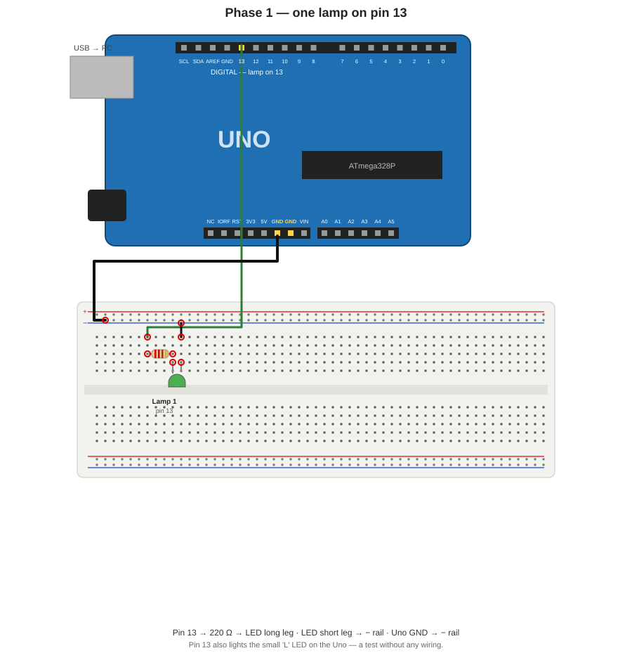
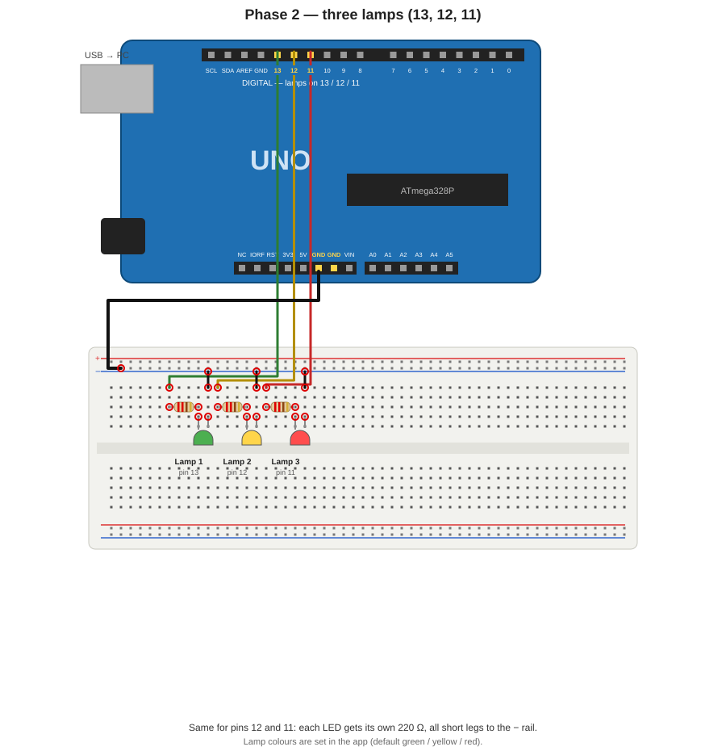
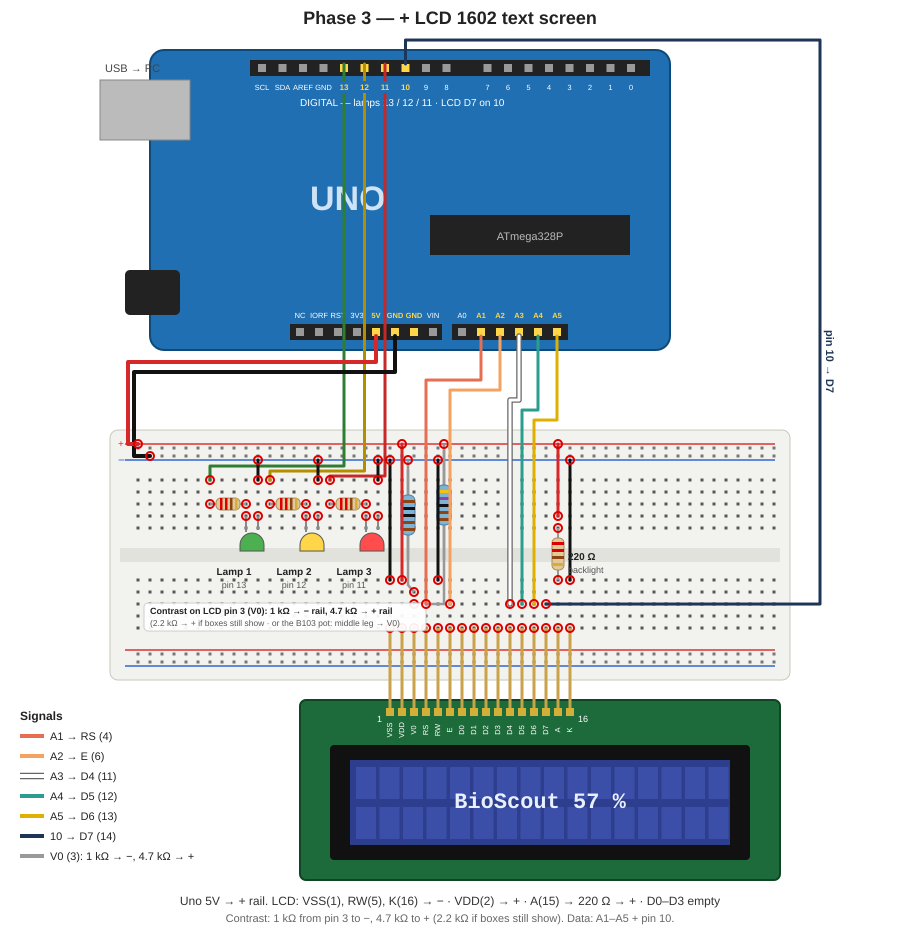
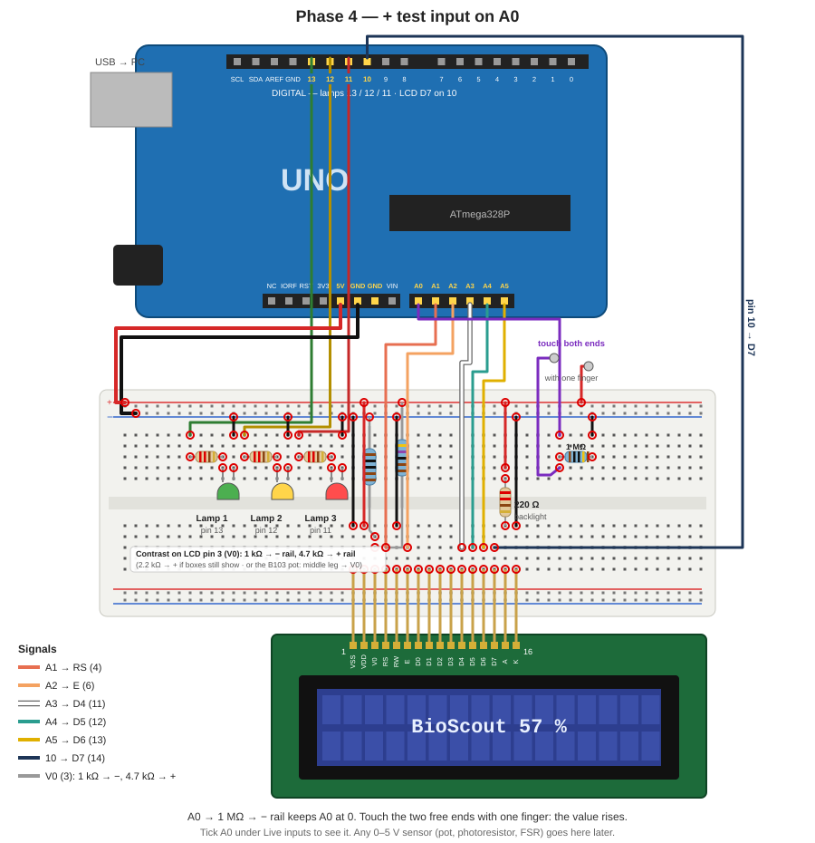
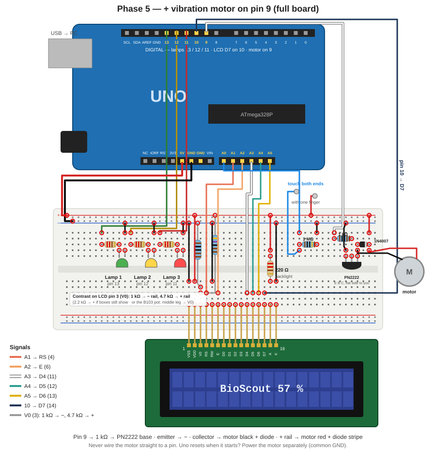
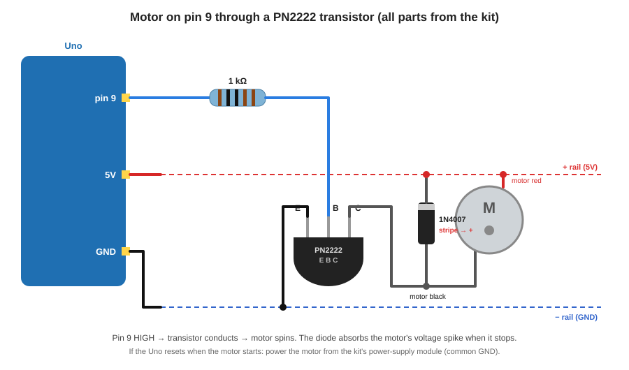

# BioScout Arduino — build it step by step

One Arduino Uno on USB, driven by **BioScout Web → BioFeedback** (Chrome or Edge on
a computer; launch locally with `_private/launchers/biofeedback.bat`). Build the board
in five phases; each one adds a part to the previous one, and each ends with a test
in the app. Everything comes from the Elegoo Uno R3 kit.

**Firmware:** the app installs it — Arduino window → **Update board firmware**
(≈10 s, the button only shows when the board is behind). If that fails: Arduino IDE
→ open `assets/arduino/biofeedback_lamp/biofeedback_lamp.ino` → Board *Arduino Uno*,
Port *COMx* → Upload, then close the IDE (only one program can use the port).

**Connect in the app:** BioFeedback → **Connect external device → Arduino → Choose
port…** → pick the Uno.

### Final pin map

| Pin | Used for | Phase |
|---|---|---|
| 13 / 12 / 11 | Lamp 1 / 2 / 3 (each via 220 Ω) | 1, 2 |
| A1 A2 A3 A4 A5 + 10 | LCD RS, E, D4, D5, D6, D7 | 3 |
| A0 | analog input (test / sensor) | 4 |
| 9 | motor (via PN2222 transistor) | 5 |
| 5V / GND | + rail / − rail of the breadboard | 1, 3 |
| 0, 1 | USB — never use | — |

Kit resistors are blue with **5 colour bands** — easiest is to read the label on
the paper strip: 220 Ω (red-red-black-black-brown), 1 kΩ (brown-black-black-brown-brown),
4.7 kΩ (yellow-violet-black-brown-brown), 1 MΩ (brown-black-black-yellow-brown).

---

## Phase 1 — one lamp

**Parts:** 1 LED, 1 × 220 Ω, 2 jumper wires.

1. Uno **GND** → breadboard **− rail** (blue line), black wire.
2. Uno **pin 13** → a column in the upper half (green wire).
3. **220 Ω** from that column to a column 3 holes to the right.
4. LED **long leg (+)** into the resistor's column, **short leg (−, flat rim)** into
   the next column.
5. Short black jumper from the short-leg column → **− rail**.

**Test:** connect in the app → Lamps → **Lamp 1** button. The LED (and the small
"L" LED on the Uno) lights. Nothing? LED backwards — swap its legs.

---

## Phase 2 — three lamps

**Parts:** 2 more LEDs, 2 × 220 Ω.

Repeat phase 1 twice: **pin 12** → 220 Ω → LED 2, **pin 11** → 220 Ω → LED 3,
every short leg → − rail. One resistor per LED, never shared.

**Test:** Lamp 1 / 2 / 3 buttons each light their own LED. In BioFeedback the three
thresholds now light the lamps (press **Activate**). Colours are set in the app
(default green / yellow / red) — use LEDs that match.

---

## Phase 3 — LCD 16×2 text screen

**Parts:** LCD1602 (no I2C board), 220 Ω (backlight), 1 kΩ + 4.7 kΩ (contrast),
~14 wires.

1. Uno **5V → + rail** (red). The − rail is already on GND.
2. Push the LCD's 16 pins into one row of the breadboard (pin 1 = VSS on the left).
3. Power: **VSS (1), RW (5), K (16) → − rail**; **VDD (2) → + rail**;
   **A (15) → 220 Ω → + rail** (backlight).
4. Data: **A1 → RS (4)**, **A2 → E (6)**, **A3 → D4 (11)**, **A4 → D5 (12)**,
   **A5 → D6 (13)**, **pin 10 → D7 (14)**. D0–D3 (7–10) stay empty.
5. Contrast on **V0 (3)**: **1 kΩ → − rail** and **4.7 kΩ → + rail** (≈0.9 V).
   Instead you can use the B103 pot: middle leg → V0, outer legs → + and −.

**Test:** press the Uno's reset → the screen shows *BioScout / ready*. In the app:
**Screen text** (type, Enter) and **Text per lamp** (shown when a line is crossed).

| What you see | Fix |
|---|---|
| Backlight but plain blue, no boxes | VSS (1) / VDD (2) not on the rails |
| Grey boxes behind the letters, text only readable at an angle | contrast too high: 4.7 kΩ → 2.2 kΩ to + (or turn the pot) |
| Text very faint | contrast too low: 4.7 kΩ → 10 kΩ to + |
| Boxes on line 1 only, never text | RS / E / D4–D7 wiring, or RW not on − |
| Garbled characters | two of D4–D7 swapped, or one wire a column off |

---

## Phase 4 — test an analog input on A0

**Parts:** 1 MΩ, 3 wires.

1. Uno **A0** → a free column (blue).
2. **1 MΩ** from that column → a column linked to the **− rail**: keeps A0 at 0 when
   nothing touches it.
3. One wire from the A0 column and one from the **+ rail**, both with a **free end**.

**Test:** Arduino window → **Live inputs** → tick **A0** (also shown under the main
plot). Touch both free ends with one fingertip: the value rises, more when you press
harder. A0 can drive a lamp: Threshold 2 or 3 → *A0 (Arduino input)*. The **×** box
next to A0 scales the value (e.g. ×0.0049 = volts).

**Pseudo-EMG on the LCD:** Arduino window → *Finger input* (A0) and *Line 2 during
BioFeedback*: **Input voltage** (V on the blue wire), **ΔV red − blue** (the drop across
your fingers: 5 V − blue; lower when you press harder) or **Pseudo-EMG** (the blue-wire
voltage with its slow baseline removed, rectified and smoothed, in mV: it bursts when you
press, squeeze or tap and falls back when you hold still, like an EMG envelope). The top
line keeps the lamp text. ΔV and Pseudo-EMG are also metrics for the thresholds and lamps.
This measures skin contact and pressure, not muscle: real EMG is µV–mV and needs
electrodes and an instrumentation amplifier. With the LCD wired (Phase 3), A1–A5 are the
screen's wires, so use A0.

Later, any 0–5 V sensor goes on A0 the same way: a potentiometer (middle leg → A0),
a photoresistor or a force sensor with a 10 kΩ divider. Never more than 5 V on A0.

---

## Phase 5 — vibration motor (full board)

**Parts:** DC motor 3–6 V, **PN2222** transistor, **1 kΩ**, **1N4007** diode.
**Never wire the motor straight to a pin** — it needs 100–250 mA, a pin gives 20 mA.

1. Uno **pin 9** → a free column (white) → **1 kΩ** → the transistor's middle leg **B**.
2. PN2222 with the **flat side towards you**: legs **E B C** from left to right.
   **E → − rail.**
3. **C** → motor **black** wire.
4. Motor **red** wire → **+ rail**.
5. **Diode** between C and the + rail, **silver stripe on the + side**
   (backwards = short circuit).

**Test:** Arduino window → **Motor** → *Start with* Lamp 1/2/3, *Pin* 9, *Seconds* 2
→ **Test motor**. Then it spins every time that lamp's line is crossed.
Uno resets or the LCD flickers when it starts? Power the motor from the kit's
power-supply module and join its GND to the Uno's GND.

---

## Reference

### Serial commands (9600 baud, one per line; Serial Monitor works too)

| Send | Does |
|---|---|
| `L0`…`L3` | lamp level (cumulative) |
| `T<pin>:1` / `T<pin>:0` | switch any pin 2–13 (pin tester, lamps, motor) |
| `P<i>:<pin>` / `?` | move lamp i to a pin (kept in EEPROM) / report pins |
| `W1:<text>` / `W2:<text>` | LCD line 1 / 2, saved (shown after power-off) |
| `w1:<text>` / `w2:<text>` | LCD line 1 / 2, not saved (lamp texts) |
| `A` / `a` | stream A0–A5 at 25 Hz on / off (`AN v0,…,v5`) |
| `V` | firmware version |

### General troubleshooting

| Symptom | Fix |
|---|---|
| "Could not open the port" / "Access is denied" | another program holds it: close the Arduino IDE, Serial Monitor or other BioScout tabs |
| No replies from the board | upload the firmware again (Update board firmware or IDE) |
| LED never lights | LED backwards, or its short leg not on the − rail |
| App says the firmware is older | **Update board firmware** |
