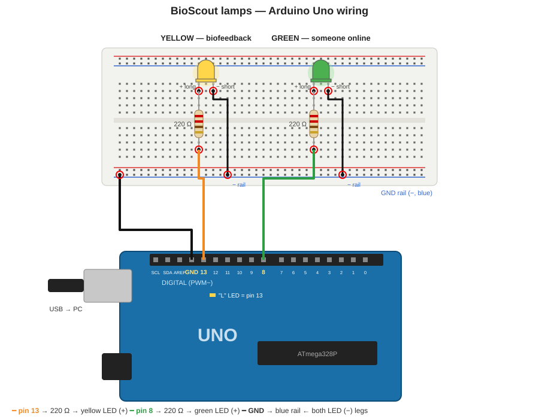

# BioScout lamps on an Arduino Uno — setup

Two lamps on one Arduino, driven by the BioScout Web **BioFeedback** page over USB
(Web Serial, Chrome / Edge on a computer):

| Lamp | Pin | Lights up when | Serial command |
|---|---|---|---|
| **Yellow** | 13 | BioFeedback: the chosen metric crosses the threshold (needs **Activate**) | `1` on · `0` off |
| **Green**  | 8  | Someone else has BioScout open (any copy of the app, lab demo or full) | `G` on · `g` off |
| Relay (optional) | 7 | Follows the yellow lamp, for a bigger lamp via a relay module | — |

Sketch: `assets/arduino/biofeedback_lamp/biofeedback_lamp.ino` (also downloadable from the
BioFeedback page, "Arduino sketch (.ino)").

---

## 1. Parts

- Arduino Uno (Elegoo Uno R3 is fine) + USB cable
- 1 × yellow LED, 1 × green LED (5 mm)
- 2 × 220 Ω resistors (red-red-brown; anything 150 Ω–1 kΩ works, higher = dimmer)
- Breadboard + 4 jumper wires
- Optional: 5 V relay **module** (with its own transistor and diode) for a lamp bigger than an LED

## 2. Schematic



```
                 ARDUINO UNO
             ┌──────────────────┐
             │             D13 ●──────[ 220 Ω ]──────►|──┐   YELLOW LED
             │                  │                  (long leg  │   (biofeedback)
             │                  │                   = +)      │
             │              D8 ●──────[ 220 Ω ]──────►|──┤   GREEN LED
             │                  │                             │   (someone online)
             │              D7 ●───────────── IN  ┐           │
             │                  │                 │ relay     │   (optional)
             │              5V ●───────────── VCC │ module    │
             │                  │                 │           │
             │             GND ●──────────────GND ┘───────────┘   common ground
             └────────●─────────┘
                     USB ──► PC running BioScout Web (Chrome / Edge)
```

LED legs: **long leg (+, anode)** towards the resistor / pin, **short leg (−, cathode, flat side
of the rim)** to GND. One resistor per LED, never shared.

Breadboard layout (top view, one way to do it):

```
  Uno D13 ── jumper ── row 10  [220 Ω: row 10 → row 14]  row 14 = yellow LED +   yellow LED − = row 15 ──┐
  Uno D8  ── jumper ── row 20  [220 Ω: row 20 → row 24]  row 24 = green  LED +   green  LED − = row 25 ──┤
                                                                                                         │
  Uno GND ── jumper ── blue (−) rail ◄── short jumpers from rows 15 and 25 ──────────────────────────────┘
```

Pin 13 also drives the small **"L" LED on the board**, so the yellow channel can be tested with
no wiring at all.

## 3. Upload the sketch

1. Arduino IDE → open `biofeedback_lamp.ino` → Tools → Board **Arduino Uno**, Port **COMx**.
2. Upload. Open the Serial Monitor at **9600 baud** once: it prints `BIOSCOUT_LAMP_READY`.
   Typing `G` / `g` / `1` / `0` there switches the lamps — a test without the app.
3. **Close the Serial Monitor / IDE** (only one program can hold the port).

## 4. Connect from BioScout Web

1. Open BioScout Web in Chrome or Edge on the PC with the Arduino (local:
   `_private\launchers\biofeedback.bat` → http://localhost:5173, or the live site).
2. Home → **BioFeedback** → **Choose port…** → pick the Uno → "Connected at 9600 baud".
3. **Test lamp on / off** → yellow. **Test green** → green flashes 1.5 s.
4. Green lamp mode (step 1 of the page):
   - **Flash when someone new arrives** (default): 3 s of green per new visitor.
   - **On while anyone else is online**: green stays on while at least one other copy is open.
   - **Off**.
   Next to it: "N other(s) online now". The green lamp works without pressing Activate; the
   yellow biofeedback lamp needs Activate.

Keep that tab open (it can be in the background, but a sleeping PC or a closed tab stops it).

## 5. How "online" works

- Every open copy of the app joins one Supabase Realtime **presence** channel
  (`bioscout-online`) with a **random code made fresh on each page load** — no account, no
  device id, nothing written to the database (`src/presence.js`).
- The BioFeedback page counts the others (its own code excluded) and sends `G` / `g`.
- Disclosed in the terms (version bumped to v4, so everyone is asked to agree again) and in
  `privacy.html` ("The online now signal").
- If the Realtime connection fails the page shows "Online count: not connected" and retries
  (1 s, 2 s, 4 s … up to 60 s). If it never connects: Supabase dashboard → Realtime →
  settings → **"Allow public access"** must be enabled (public channels with the publishable key).

## 6. Bigger lamps

An Arduino pin gives ~20 mA: enough for an LED, not for a bulb, a motor or an LED strip.
- Relay module on **pin 7** (already in the sketch, follows yellow). For green, move the relay's
  IN to pin 8 instead.
- Mains lamps only through an **enclosed, isolated** relay module — never bare mains wiring on a
  breadboard.
- DC motor / LED strip: logic-level MOSFET (e.g. IRLZ44N) from the pin, flyback diode across a motor.

## 7. Troubleshooting

| Symptom | Fix |
|---|---|
| LED never lights, `← ON` / `← GREEN_ON` appears in the Serial log | Wiring: LED backwards (swap legs) or no common GND |
| No `←` replies at all | Board runs another sketch → upload `biofeedback_lamp.ino` again |
| "Could not open the port" | IDE Serial Monitor still open; close it |
| Green never lights, count says "not connected" | See §5 (Realtime public access / network) |
| LED very bright / orange-ish | No resistor — add the 220 Ω |

## 8. Three-level lamps (sketch v3)

The app now has three thresholds — **yellow, orange, red** — and the lamps light cumulatively
(level 1 = yellow, 2 = yellow + orange, 3 = all three). Default pins:

| Lamp | Pin | Command |
|---|---|---|
| Yellow | 13 | `L1` (or `1`) |
| Orange | 12 | `L2` |
| Red | 11 | `L3` |
| Green (someone online) | 8 | `G` / `g` |
| Relay (any level on) | 7 | follows `L1`–`L3` |

Each LED gets its own 220 Ω resistor; all short legs go to the GND rail, as for yellow.

**Change pins without re-uploading:** Connect external device → Arduino → *Pins*. The app sends
`P<i>:<pin>` (e.g. `P1:10` puts orange on pin 10); the board keeps it in EEPROM and answers
`PINS 13,12,11,8,7`. `?` asks for the current pins.

**Edit the sketch:** *Edit Arduino sketch…* opens the code in a window (kept in your browser).
Download the .ino and upload with `_private/launchers/flash_arduino.bat` or the Arduino IDE — a browser
cannot compile Arduino code.

An old (v2) board still works for yellow and green; the app says so and asks for the upload.
